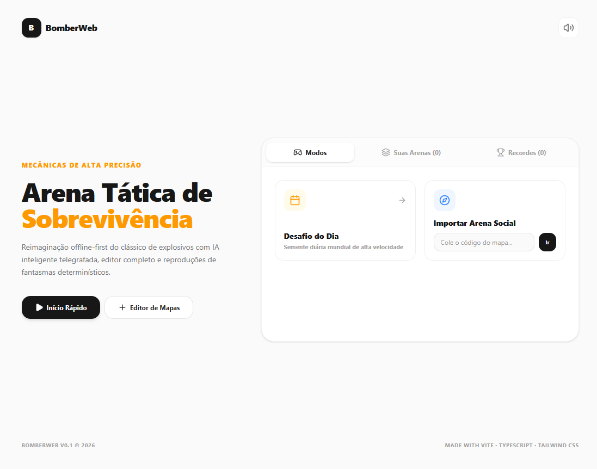

<div align="center">

# 💣 BomberWeb

### Arena Tática de Sobrevivência & Editor de Arenas

Uma reimaginação contemporânea, precisa e *offline-first* do clássico arcade de explosivos.  
Construído inteiramente no navegador com física determinística, inimigos inteligentes telegrafados, replay de fantasmas e compartilhamento instantâneo via URL.

---

[](https://github.com/leohconstantino/bomber-web/actions)
[](https://react.dev/)
[](https://www.typescriptlang.org/)
[](https://vitejs.dev/)
[](https://tailwindcss.com/)
[](LICENSE)

<br />

👉 **[JOGAR AGORA NO GITHUB PAGES](https://leonardoconstantino.github.io/bomber-web/)** 👈

<br />

<!-- ==================== HERO PREVIEW BANNER ==================== -->
<p align="center">
  
</p>
<sub><em>💡 Dica: Salve o print da tela inicial do jogo como <code>hero.png</code> dentro da pasta <code>assets/</code> para exibir sua captura de tela acima!</em></sub>
<!-- ============================================================== -->

</div>

<br />

## 🌟 Principais Recursos

- 🎯 **Motor Físico Determinístico em Grid:** Movimentação em tick fixo (60 FPS) com deslizamento suave de quinas (*corner sliding*) para máxima responsividade competitiva.
- 🛠️ **Editor Visual de Arenas Completo:** Desenhe mapas personalizados, configure taxas de spawn de itens, posicionamento de blocos e posições iniciais de jogador e inimigos.
- 👻 **Corridas Contra Fantasma (*Ghost Run*):** Grave suas jogadas vencedoras e desafie a si mesmo ou amigos contra um fantasma transparente da melhor tentativa.
- 👾 **4 Arquétipos de IA Inimiga com Telegrafia Visual:**
  - 👻 **Phantom (Fantasma):** Atravessa blocos destrutíveis e persegue lentamente.
  - 🦍 **Brute (Brutamontes):** Quebra obstáculos no caminho e avança agressivamente.
  - 🦊 **Trickster (Trapaceiro):** Planta armadilhas e esquiva ativamente de raios de explosão.
  - 🏹 **Hunter (Caçador):** Perseguição clássica de rota ótima (*pathfinding A\**).
- ⚡ **Poderes e Aprimoramentos Variados:** Aumento de raio de explosão, bombas adicionais, patins de velocidade, bomba remota detonável, escudo de proteção e chute de bombas.
- 📅 **Desafio Diário Mundial:** Uma arena gerada proceduralmente a cada dia baseada na data (`YYYY-MM-DD`), garantindo o mesmo desafio para todos os jogadores do mundo.
- 🔗 **Compartilhamento Social via URL:** Arenas criadas e replays de fantasmas são compactados com LZ-String e embutidos diretamente na URL (`?m=...`), sem necessidade de banco de dados ou backend.
- 🔊 **Áudio Procedural via Web Audio API:** Efeitos sonoros de passos, fusíveis, explosões e power-ups sintetizados em tempo real, sem arquivos externos pesados.
- 📴 **100% Offline-First:** Toda a lógica roda no navegador do usuário e armazena mapas e recordes pessoais com persistência local em `localStorage`.

---

## 🎮 Controles do Jogo

| Ação | Teclado (Padrão) | Alternativo |
| :--- | :--- | :--- |
| **Mover Jogador** | <kbd>W</kbd> <kbd>A</kbd> <kbd>S</kbd> <kbd>D</kbd> | <kbd>↑</kbd> <kbd>←</kbd> <kbd>↓</kbd> <kbd>→</kbd> |
| **Plantar Bomba** | <kbd>Espaço</kbd> | <kbd>J</kbd> |
| **Detonar Bomba Remota** | <kbd>E</kbd> | <kbd>K</kbd> |
| **Pausar / Retomar** | <kbd>P</kbd> ou <kbd>Esc</kbd> | — |
| **Reiniciar Partida** | <kbd>R</kbd> | — |

---

## 🚀 Como Executar Localmente

### Pré-requisitos
- [Node.js](https://nodejs.org/) versão 18 ou superior
- Gerenciador de pacotes `npm` ou `bun`

### Passo a Passo

1. **Clone o repositório:**
   ```bash
   git clone https://github.com/leohconstantino/bomber-web.git
   cd bomber-web
   ```

2. **Instale as dependências:**
   ```bash
   npm install
   ```

3. **Inicie o servidor de desenvolvimento:**
   ```bash
   npm run dev
   ```
   Abra seu navegador em [http://localhost:3000](http://localhost:3000).

4. **Gerar build de produção:**
   ```bash
   npm run build
   ```
   Os arquivos otimizados serão gerados no diretório `dist/`.

---

## 📦 Deploy no GitHub Pages

O projeto conta com uma pipeline automatizada via **GitHub Actions** em `.github/workflows/deploy.yml`.

A cada `git push` na branch `main` ou `master`, o workflow:
1. Faz o checkout do código.
2. Instala as dependências (`npm ci` / `npm install`).
3. Compila a aplicação configurando o `base: '/bomber-web/'`.
4. Publica a pasta `dist` diretamente no GitHub Pages.

> **Configuração necessária no GitHub:**  
> Certifique-se de que em **Settings > Pages > Build and deployment > Source**, a opção **GitHub Actions** está selecionada.

---

## 🛠️ Tecnologias Utilizadas

- **Core:** [React 19](https://react.dev/), [TypeScript](https://www.typescriptlang.org/)
- **Bundler:** [Vite 6](https://vitejs.dev/)
- **Estilização:** [Tailwind CSS v4](https://tailwindcss.com/)
- **Animações:** [Motion](https://motion.dev/)
- **Ícones:** [Lucide React](https://lucide.dev/)
- **Compressão de Mapas:** [lz-string](https://github.com/pieroxy/lz-string)
- **Áudio:** Web Audio API nativo do navegador

---

## 📄 Licença

Este projeto está sob a licença [MIT](LICENSE). Sinta-se livre para usar, modificar e distribuir.

<div align="center">
  <sub>Criado com paixão por jogos retrô e engenharia web moderna.</sub>
</div>
